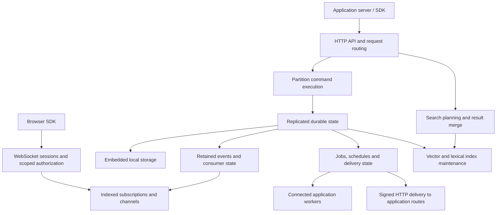

# SubstrateDB architecture

Status: approved product design, with a runnable Rust implementation added 2026-10-21. Rust and Apache-2.0 are confirmed. The sections below preserve the intended architecture; [implementation status](docs/IMPLEMENTATION.md) and [operations](docs/OPERATIONS.md) distinguish implemented mechanisms from remaining production qualifications.

## Product

An open-source, independently deployable runtime for documents, vector/hybrid search, durable messaging, cache primitives, scheduling, and direct browser realtime. One executable/image supports standalone operation and a replicated/sharded cluster without an external coordinator. A hosted Vercel integration is optional future work, conditional on the open-source project's usefulness.

The implementation uses Rust, a native TypeScript server/browser SDK, Linux/Docker packaging and macOS/Linux local development. It embeds redb for transactions and incremental Raft logs, OpenRaft for consensus, Tokio/Axum for transport, and a persisted experimental graph plus exact vector search and BM25 lexical postings. These choices are implemented, but the graph and workload isolation remain subject to performance qualification.

## Proposed component boundaries

These are modules in one distribution, not a set of independently operated products. Ephemeral cache/channel state has separate policies and resource accounting from durable records.

## Durable core and partitioning

Propose multiple replicated partition groups rather than one global write log. Evaluate a mature consensus implementation, with Raft as a candidate. Embed cluster metadata coordination in the runtime; do not require etcd or another external service.

A namespace scopes credentials, data, and limits. A logical partition key determines which records can participate in one atomic command. Physical shard placement remains independent and may evolve. Initial transactions cannot span unsupported logical partitions; reject them explicitly.

A command that saves an order and enqueues a job commits both through the same partition state machine. Replays and uncertain client retries require operation identities and bounded deduplication. Do not claim permanent exactly-once execution.

Replicated durable success must survive one node failure in a properly configured three-node deployment. Loss of a majority pauses/fails durable writes rather than creating divergent histories. Define the actual disk persistence and acknowledgement protocol during engine evaluation. Standalone mode has local durability but no machine-loss tolerance.

Evaluate how the consensus log, local write-ahead log, snapshots, and event-retention log interact. They have different retention purposes and should not be assumed to be one unbounded log. Reuse embedded storage where appropriate, including C/C++ libraries behind Rust interfaces if justified.

## Documents and live queries

Initial queries support nested documents, CRUD, conditional updates, secondary/compound indexes, filtering, sorting, projection, and pagination. Aggregation is planned later; keep the query representation extensible. Joins are deferred.

Live subscriptions cover individual documents and indexed filtered sets. Establish a snapshot and a change position without losing updates between them. Mutations may add a document to a result, change it, or remove it. Authorization must cover snapshots, updates, removal payloads, replay, and reconnect.

Bound per-client buffering and define slow-consumer recovery. Reject unsupported/unindexed subscriptions explicitly. Sorted top-N, aggregation, and continuous nearest-neighbor subscriptions are outside the initial boundary.

## Vector and hybrid search

Documents own dense/sparse named vectors supplied by application workers. Include metadata filters, exact and approximate search, dense cosine/dot/Euclidean metrics, ranked keyword retrieval, fusion, and batch mutation. Token-level multivectors and in-runtime model inference are deferred.

Propose asynchronous derived indexes driven by committed state. A durable mutation and a search-visible mutation are distinct: expose indexing progress and an explicit wait/barrier. Design per-partition visibility positions and replica selection; do not let a wait on one node falsely guarantee visibility on another.

Exact search supplies a baseline for recall checks and may serve small candidate sets. Evaluate approximate indexes, lexical/inverted indexes, disk-backed options and quantization against filtered workloads before selecting libraries. HNSW and BM25 are candidates, not adopted dependencies or algorithms.

Version vector updates against source documents to prevent delayed embedding jobs from overwriting newer representations. Enforce deletions and current access rules even while derived indexes lag. Define precisely whether a query filters candidates against current authoritative state or another validated visibility view.

Cross-partition search fans out and merges results without implying cross-partition write transactions. Candidate budgets, filter selectivity, tenant locality and skew must be benchmarked; local approximate top-k merging does not automatically preserve a desired global recall.

## Messaging and execution

Separate three public contracts: current live-query state, retained event consumption, and competing job consumers. Include fanout, exact/wildcard topics, delayed delivery, retries, dead-letter inspection, and request/reply with deadlines. Namespace-level routing must not leak data across scopes.

Events are ordered per logical partition, not globally. Jobs optionally serialize by ordering key. Specify whether terminal failures unblock an ordered key; this is still open. Stable job IDs support application idempotency, but no database protocol can ensure exactly-once external payments or emails.

Connected workers pull work; the HTTP dispatcher invokes signed application endpoints. Candidate delivery protocol: persisted claims/leases, bounded outstanding work, explicit acknowledgement and retry state. HTTP responses need an exact success contract; accepting a request while processing continues is not automatically completion.

Pending jobs survive independently of event-history retention. Exhausted capacity applies backpressure or rejects new submissions. Retention gaps are explicit. Retry limits, backoff, expiry, and dead-letter retention are configurable; numerical defaults need testing.

Cron is part of the runtime. Schedules default to UTC, optionally use IANA timezones, and default to one catch-up occurrence, skipping nonexistent local times, running once in repeated local times, and avoiding overlapping execution. Propose a stable schedule-occurrence identity and durable scheduling ownership to prevent duplicate enqueue during failover. A timed-out external worker may still run: overlap prevention requires a precise cooperative-worker/fencing contract, not merely a lease timeout.

## Cache, channels, and browser access

Cache primitives include TTL values, counters, hashes, lists, sets, sorted sets, and building blocks for rate limits and leases. Eviction must never silently remove authoritative documents or accepted work. Default cache replication/durability and exact operation atomicity remain to be specified; do not imply that an expiring lock alone is a safe fencing mechanism.

Browser access uses application-issued scoped credentials. Initial permissions cover subscriptions, channel publishing and presence; trusted application servers handle document mutation and job administration. Presence is ephemeral and disconnect detection is time-bounded rather than instantaneous.

Validate resources and operations independently of browser-supplied filters. Support expiry-bounded revocation and explicit urgent revocation/disconnection, including reconnect checks. Define propagation bounds and behavior for isolated nodes. The managed-product identity system is not a prerequisite.

Server APIs should suit short-lived HTTP clients; browsers use WebSockets. Local IPC and worker transport selection remain engineering evaluation items. The SDK should hide ordinary routing and reconnect mechanics while exposing irrecoverable history gaps and ambiguous write outcomes.

## Operations and isolation

Initial production topology is one region across failure zones. Cross-region DR and active-active writes are later work. Node discovery, placement, shard movement, membership changes and online index rebuilds need explicit failure-tested protocols; none is considered solved by this draft.

Enforce namespace budgets and separate background indexing/compaction from commit and delivery control. Bound fanout, outstanding requests and memory. This is required by combining workloads, not optional tuning after benchmarks fail.

First production release includes consistent backup/restore. A backup manifest must identify compatible document, queue, schedule, event and index state or permit derived-index rebuild. Define the cross-partition snapshot boundary explicitly. Restore starts schedules and queues paused so external side effects can be reconciled. Connections and in-flight external effects are not restored as if time had stopped. Incremental backup and point-in-time recovery remain open.

## Proposed implementation sequence and evidence gates

1. Durable vertical slice: document CRUD/indexes, atomic save-plus-job, pull/HTTP delivery, restart recovery, native SDK. Single-node development is a milestone, not the complete product.
2. Replicated core: quorum durability, partition groups, membership/failover, event positions and fault tests. Validate acknowledged writes and job ownership through crashes and partitions.
3. Realtime and scheduling: indexed snapshot-to-feed handoff, scoped browser channels, durable consumers, cron occurrence recovery, retention and backpressure.
4. Search vertical slice: document-native vector/lexical indexes, filtering/fusion, visibility barriers and mixed-load benchmarks. Evaluate vector candidates early alongside the first storage spike so the storage design does not ignore search requirements.
5. Production gates: sharding/rebalance, backup/restore, namespace isolation, upgrade compatibility, observability and sustained-load/fault validation.

All core capabilities remain required for the intended production release. Package the sequence as small work packages once the design is confirmed; do not label an intermediate subset the completed product.

Benchmark multi-tenant knowledge retrieval around 1M vectors on one node and 10M in a cluster, alongside document writes and job traffic. Fix hardware, dimensions, data distribution, filter selectivity, durability and concurrency. Measure recall, p95/p99 latency, throughput, memory/disk use, indexing lag and recovery. Numerical targets and comparison baselines are not yet established.

## Decisions still needed

Rust and Apache-2.0 are confirmed. Implemented defaults and contracts are in the protocol/operations documents. Remaining engineering decisions concern the production ANN/index representation, namespace-wide workload isolation, global search ranking, fleet backup orchestration, migration/upgrade protocol and quantitative release thresholds. The current implementation does not establish those by omission.
